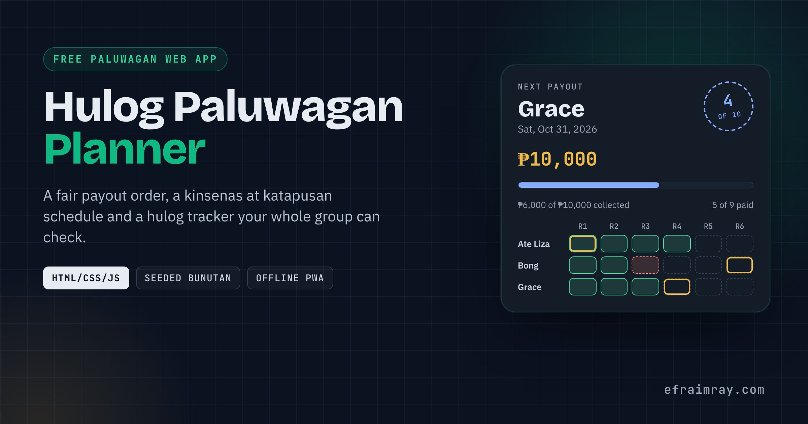

# Hulog Paluwagan Planner

**Plan a paluwagan, draw a fair payout order and track every hulog, right in the browser. Free, private and works offline.**

    



**Live demo:** https://efraimray.github.io/hulog-paluwagan/

> New here? Read [docs/BUILD-LOG.md](docs/BUILD-LOG.md) for the languages used and how this was built.

A *paluwagan* is a rotating savings group: every member pays the same *hulog* (contribution) each payday, and one member takes home the whole pot each round until everyone has had a turn. It usually lives in one person's notebook and a busy group chat. Hulog turns it into a clear schedule, a fair draw and a tracker that anyone in the group can check.

## Features

- **Payout calendar** for weekly, every 2 weeks, *kinsenas at katapusan* (15th and end of month) and monthly groups. Short months are handled (Jan 31 -> Feb 28 -> Mar 31) and Sunday payouts can move to Monday.
- **More than one ulo per member.** A member can hold up to 5 slots; they pay for each slot and receive a payout per slot.
- **Fair bunutan (draw lots).** A seeded shuffle: type a seed the group agrees on and the order is the same every time, so anyone can re-check it.
- **Manual order** with up/down buttons, or A-Z.
- **Hulog tracker.** Tap a box when someone pays. Late boxes turn red after the payout date; each member's own payout round is ringed in gold.
- **Summary at a glance:** next payout, how much is collected, pot per round and who is behind.
- **Per-member totals:** what each person pays in, receives and has paid so far.
- **Optional organizer fee** (fixed peso amount or percent of the pot, capped at 20%).
- **Share and backup:** Messenger/Viber-ready summary, CSV for Excel or Google Sheets (protected against formula injection), JSON backup and validated restore.
- **Private and offline.** No account, no server; data stays in the browser. Installable as a web app.
- Light and dark themes, keyboard-friendly tabs, screen-reader labels on every tracker box.

## Tech Stack

| Layer | Technology |
|---|---|
| Markup | HTML5 (semantic landmarks, ARIA tabs) |
| Styling | CSS3 with custom properties (light and dark tokens), no framework |
| Logic | Vanilla JavaScript (ES5-compatible), UMD module for browser and Node |
| Storage | `localStorage` (wrapped in try/catch) |
| Offline | Service worker + web app manifest |
| Tests | Node.js built-in test runner, Playwright + Chromium |

No npm install, no bundler, no build step to run the app.

## Folder Structure

```
hulog-paluwagan/
|-- index.html              The app (served at the GitHub Pages root)
|-- css/hulog.css           Design tokens, layout, light/dark themes, print styles
|-- js/hulog-core.js        Pure logic: dates, schedule, draw, export, import (no DOM)
|-- js/hulog-app.js         User interface: rendering, events, storage
|-- sw.js                   Offline cache
|-- manifest.webmanifest    Install-as-app metadata
|-- favicon.svg             Icon
|-- demo/index.html         Single-file build (CSS + JS inlined)
|-- tools/build-demo.js     Builds demo/index.html
|-- tests/core.test.js      12 unit tests (node --test)
|-- tests/ui.e2e.js         Browser test (Playwright)
|-- docs/                   BUILD-LOG, TUTORIAL, DEPLOYMENT
|-- publish-to-github.bat   Double-click publisher (Windows)
`-- publish-to-github.ps1   The PowerShell script it runs
```

## Quick Start

1. Download the release zip and extract it, or clone the repo.
2. Double-click `index.html`. That's it. (For offline install support, serve the folder over `http://localhost` or HTTPS.)

```bash
git clone https://github.com/EfraimRay/hulog-paluwagan.git
cd hulog-paluwagan
python -m http.server 8080   # then open http://localhost:8080
```

## Usage

1. **Settings:** name the group, set the hulog per ulo, the first payout date and how often.
2. **Members & bunutan:** add members, give someone a second ulo with **+**, then type a seed and press **Draw order** (or arrange the order by hand).
3. **Hulog tracker:** tap each member's box when they pay.
4. **Share & backup:** copy the group chat summary, export CSV, and save a backup now and then.

The app opens with a fictional sample group ("Barkada sa Opisina") so you can try everything first.

## Configuration

| Setting | Options |
|---|---|
| Frequency | Weekly, Every 2 weeks, Kinsenas at katapusan, Monthly |
| Sunday payouts | Keep Sunday, Move to Monday |
| Organizer fee | None, fixed peso amount, percent of pot (max 20%) |
| Ulo per member | 1 to 5 |
| Limits | 2 to 60 members, up to 120 rounds, up to PHP 1,000,000 per hulog |

Developers can change limits at the top of `js/hulog-core.js` (`MAX_HANDS`, `MAX_MEMBERS`, `MAX_AMOUNT_CENTS`).

## Deployment

- **Easiest (Windows):** double-click `publish-to-github.bat`. It creates the GitHub repository, pushes the code, makes the v1.0.0 release with a zip, and turns on GitHub Pages.
- Any static host works: GitHub Pages, Netlify, Cloudflare Pages, or plain shared hosting (upload the folder with cPanel File Manager).

Full steps: [docs/DEPLOYMENT.md](docs/DEPLOYMENT.md).

## Customization

- **Colours and fonts:** edit the tokens at the top of `css/hulog.css` (`--accent`, `--gold`, `--paper` and the dark-theme block).
- **Wording / language:** all labels live in `js/hulog-app.js`; frequency names live in `FREQ_LABELS` in `js/hulog-core.js`.
- **Branding for a client** (cooperative, office, school): change the wordmark in `index.html`, the icon in `favicon.svg`, and the name in `manifest.webmanifest`.
- After changing files, run `node tools/build-demo.js` to refresh the single-file `demo/index.html`.

## Roadmap

- Shared group view: a read-only link the organizer can send to members.
- Partial payments and "abono" (advance payment) tracking.
- Reminder text per member ("Hi Bong, hulog for Oct 15 is still open").
- Filipino / Cebuano interface switch.

## Contributing

Issues and pull requests are welcome. Please run `npm test` (no install needed, it uses Node's built-in runner) before sending changes, and keep the app framework-free.

## Requesting improvements

Open an issue and add the **`claude-improve`** label. The nightly showcase run picks up labeled issues, implements them, bumps the version and prepares a new release.

## License

[MIT](LICENSE) (c) 2026 Efraim Ray.

Hulog is a planning tool, not a bank, lending or payment service. It does not hold or move money.

## Author

**Efraim Ray** - web developer and AI automation specialist in Valencia City, Bukidnon, Philippines - https://www.efraimray.com/
